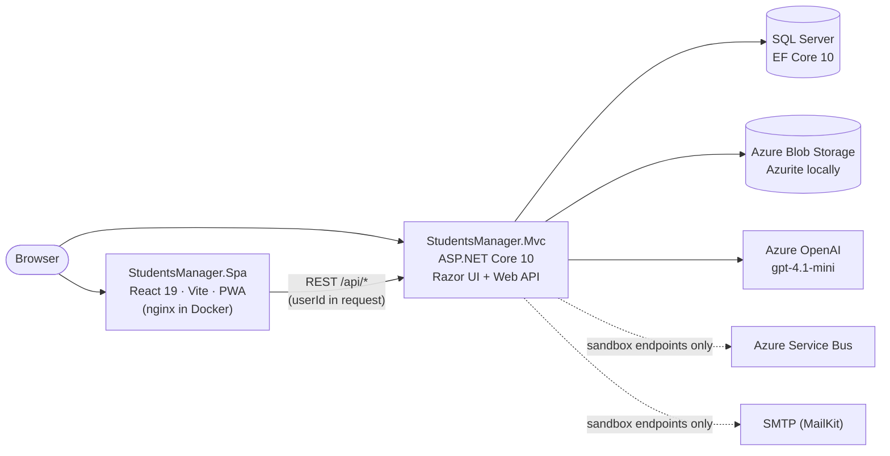

# StudentsManager

StudentsManager is a teaching platform for the *Hybrid Mobile App* course at the University of Economics – Varna. Students use it throughout the course to take topic tests, surveys, quizzes and AI-graded examinations, and they extend it as part of their coursework.

The solution contains two applications that share one backend:

- **[StudentsManager.Mvc](StudentsManager.Mvc)**: an ASP.NET Core 10 application that serves the original Razor UI **and** the REST API (`/api/*`).
- **[StudentsManager.Spa](StudentsManager.Spa)**: a React 19 + Vite progressive web app. It's the student-facing front end built on that API.

[](https://github.com/profjordanov/students-manager/actions/workflows/docker-compose.yml)
[](https://github.com/profjordanov/students-manager/actions/workflows/dotnet-deploy.yml)
[](https://github.com/profjordanov/students-manager/actions/workflows/docker-build-spa.yml)
[](https://github.com/profjordanov/students-manager/actions/workflows/github-code-scanning/codeql)
[](https://www.codefactor.io/repository/github/profjordanov/students-manager)
[](https://sonarcloud.io/summary/new_code?id=profjordanov_students-manager)
[](https://gitdiagram.com/profjordanov/students-manager?utm_source=readme&utm_medium=badge)

## Contents

- [Environments](#environments)
- [Architecture](#architecture)
- [Repository layout](#repository-layout)
- [Getting started](#getting-started)
- [Configuration](#configuration)
- [StudentsManager.Mvc](#studentsmanagermvc)
- [StudentsManager.Spa](#studentsmanagerspa)
- [Robo assessments](#robo-assessments)
- [API reference](#api-reference)
- [Tests](#tests)
- [CI/CD](#cicd)
- [Security notes and known issues](#security-notes-and-known-issues)
- [Contributing](#contributing)
- [License](#license)

## Environments

| Environment | URL | Notes |
|---|---|---|
| MVC app & API | https://students-manager.azurewebsites.net/ | Deployed from `main` to Azure App Service. The API base is `/api`. |
| React SPA | https://students-manager-spa-ehfpf6a6ekaddwgw.westeurope-01.azurewebsites.net/ | Uses the API above by default. |

## Architecture



- **One backend:** `StudentsManager.Mvc` hosts the MVC controllers, Razor views and Razor Pages that use ASP.NET Core Identity cookie authentication. It also hosts the API controllers under `/api/*`. The CORS policy allows any origin, so the SPA can be hosted separately.
- **SPA identity:** The SPA doesn't use tokens. `POST /api/login` returns the user's ID, the SPA stores it in `sessionStorage`, and later requests send it as `userId`.
- **Data:** Entity Framework Core 10 on SQL Server. At startup, the app applies pending migrations, upgrades legacy RoboExamination definitions and seeds reference data.
- **Integrations:**
  - Azure Blob Storage holds a container per user for uploads. Use Azurite locally.
  - Azure OpenAI grades RoboExamination answers.
  - Azure Service Bus and SMTP are currently used only by the `/api/sandbox/*` diagnostics. The background service that processed examination answers from Service Bus is disabled in `Program.cs`.

### Tech stack

| Area | Technologies |
|---|---|
| Backend | .NET 10, ASP.NET Core MVC + Razor Pages, ASP.NET Core Identity, EF Core 10 (SQL Server), Newtonsoft.Json |
| Azure & external services | Azure.Storage.Blobs, Azure.Messaging.ServiceBus, Microsoft.Extensions.Azure, OpenAI SDK (Azure OpenAI v1 endpoint), MailKit |
| Frontend | React 19, React Router 7, Vite 7 (`rolldown-vite`), vite-plugin-pwa, axios, GSAP, Typed.js, Font Awesome |
| Tests | xUnit, Moq |
| Delivery | Docker, Docker Compose, nginx, GitHub Actions, Azure App Service, Docker Hub |

## Repository layout

```text
StudentsManager.Mvc/
  Controllers/          MVC controllers (Razor UI) and API controllers (/api/*)
    _Base/              BaseController, [RequireAdminKey] filter, RoboExamination response helpers
  Pages/                Razor Pages: Homework, Coursework, First/SecondExamination, Grading, Profile, Admin
  Views/                Razor views for the MVC controllers
  Domain/               Entities, input models and view models
  Services/             Feature services (RoboQuizzes, RoboExaminations, Surveys, ...) and database seeders
  Persistence/          ManagerDbContext and model configuration
  Migrations/           EF Core migrations (applied automatically at startup)
  Settings/             Strongly typed configuration classes
  Resources/            Embedded JSON question sets for the Click questionnaire
  wwwroot/              Static assets for the Razor UI
StudentsManager.Spa/
  src/pages/            Route-level pages
  src/components/       Layout, Quiz (RoboQuiz) and Chatbot (RoboExamination) components
  src/services/         API clients and apiConfig.js (API base URL)
  src/context/          AuthProvider (sessionStorage-based user ID)
  public/               PWA icons and fonts
  nginx/                nginx configuration for the production container
StudentsManager.Tests/  xUnit unit tests and SQL Server-backed integration tests
docker-compose.yml               Base services: SQL Server, Azurite, MVC, SPA
docker-compose.override.yml      Local development settings, ports and volumes
docker-compose.integration.yml   Docker test environment
run-app.sh, run-down-app.sh, run-tests.sh, push-app.sh   Docker Compose helper scripts
```

## Getting started

### Prerequisites

- [.NET 10 SDK](https://dotnet.microsoft.com/download)
- Node.js 20.19+ or 22.12+ (required by Vite 7) with npm
- SQL Server: LocalDB, a container or a remote instance
- Docker Desktop, if you want the containerized stack
- Optionally, [Azurite](https://learn.microsoft.com/azure/storage/common/storage-use-azurite) for blob storage, and an Azure OpenAI deployment for RoboExamination grading

### Option 1: Full stack with Docker Compose

```bash
docker compose -f docker-compose.yml -f docker-compose.override.yml -p studentsmanager up --build -d
```

| Service | Address |
|---|---|
| SQL Server 2019 (`data`) | `localhost:1433` |
| Azurite blob storage | `localhost:10000` |
| MVC app (`studentsmanager.mvc`) | Ports 80/443 are published to random host ports (see below) |
| SPA (`studentsmanager.spa`) | http://localhost:3000 |

Find the MVC host port, then stop the stack when you're done:

```bash
docker compose -f docker-compose.yml -f docker-compose.override.yml -p studentsmanager port studentsmanager.mvc 80
docker compose -f docker-compose.yml -f docker-compose.override.yml -p studentsmanager down
```

> [!NOTE]
> - The SPA image is built without `VITE_API_BASE_URL`, so the containerized SPA calls the **deployed** API, not the local MVC container. To use the local backend, run the SPA with `npm run dev` (see [Option 3](#option-3-run-the-spa-locally)), or rebuild the image with a `VITE_API_BASE_URL` build argument.
> - The override file supplies placeholder `ServiceBusSettings` values. RoboExamination grading reads its Azure OpenAI endpoint and key from those settings (see [Configuration](#configuration)), so AI grading doesn't work in the container unless you provide real values.
> - The MVC container mounts user secrets and development HTTPS certificates from `${APPDATA}`, which matches the Windows layout.

The helper scripts wrap these commands in a POSIX shell:

| Script | Command |
|---|---|
| `run-app.sh` | Starts the stack with the `studentsmanager` project name (no `--build`) |
| `run-down-app.sh` | `docker-compose down` (no `-p` flag; prefer the explicit `down` command above) |
| `run-tests.sh` | Runs the [Docker test environment](#tests) |
| `push-app.sh` | `docker-compose push` for the built images |

### Option 2: Run the MVC app locally

```bash
cd StudentsManager.Mvc
dotnet user-secrets set "ConnectionStrings:DefaultConnection" "<sql-server-connection-string>"
dotnet user-secrets set "StorageSettings:AzureConnectionString" "UseDevelopmentStorage=true"
dotnet user-secrets set "StorageSettings:PathBasis" "http://127.0.0.1:10000/devstoreaccount1/"
dotnet user-secrets set "ServiceBusSettings:AzureConnectionString" "https://<resource>.openai.azure.com/"
dotnet user-secrets set "ServiceBusSettings:QueueName" "<azure-openai-api-key>"
dotnet user-secrets set "AdminExaminationSettings:AdminKey" "<private-admin-key>"
dotnet run
```

- The `StudentsManager.Mvc` launch profile listens on `https://localhost:5001` and `http://localhost:5000`.
- Only the connection string is needed to start the app. The other settings are needed by specific features (see [Configuration](#configuration)). `UseDevelopmentStorage=true` requires Azurite running locally.
- On startup, the app migrates and seeds the configured database. Point it at a disposable or intentionally prepared database.
- After an SDK or package update, stop the MVC process, run `dotnet clean`, `dotnet restore` and `dotnet build` against `StudentsManager.Tests/StudentsManager.Tests.csproj` (which also rebuilds MVC), then restart. Running processes keep their old assemblies.

### Option 3: Run the SPA locally

```bash
cd StudentsManager.Spa
npm install
npm run dev
```

The Vite dev server runs on http://localhost:5173. By default, the SPA calls the deployed API. To use a local backend, create `StudentsManager.Spa/.env.local`, which git ignores:

```dotenv
VITE_API_BASE_URL=https://localhost:5001/api
```

| npm script | Purpose |
|---|---|
| `npm run dev` | Start the Vite dev server with hot reload |
| `npm run build` | Create a production bundle in `dist/`, including the service worker and manifest |
| `npm run preview` | Serve the production bundle locally |
| `npm run lint` | Run ESLint (flat config in `eslint.config.js`) |
| `npm run generate-pwa-assets` | Regenerate PWA icons from `src/assets/icons/logo.svg` |

## Configuration

The MVC app reads the committed `appsettings.json` and `appsettings.Development.json`, user secrets (in Development) and environment variables. In environment variables, use `__` as the section separator, for example `ConnectionStrings__DefaultConnection`. Keep connection strings, keys and production credentials out of source control.

| Key | Used for | Needed when |
|---|---|---|
| `ConnectionStrings:DefaultConnection` | EF Core / SQL Server, migrations and seeding at startup | Always |
| `StorageSettings:AzureConnectionString` | Blob client. The app creates a per-user container on registration and stores homework, examination and survey uploads. | Registration and uploads |
| `StorageSettings:PathBasis` | Base URL for stored file links (`{PathBasis}{userId}/{fileName}`) | Uploads |
| `ServiceBusSettings:AzureConnectionString` | **Azure OpenAI endpoint** for RoboExamination grading, for example `https://<resource>.openai.azure.com/`. Also used as the Service Bus connection string by `/api/sandbox/bus`. | AI grading |
| `ServiceBusSettings:QueueName` | **Azure OpenAI API key** for grading. Also used as the queue name by `/api/sandbox/bus`. | AI grading |
| `AdminExaminationSettings:AdminKey` | Value expected in the `X-Admin-Key` header on the [admin endpoints](#course-and-examination-settings). If it's empty, those endpoints always return 401. | Admin endpoints |
| `MailSettings:Mail`, `DisplayName`, `Password`, `Host`, `Port` | SMTP via MailKit (StartTLS), used only by `/api/sandbox/mail` | Optional |

`AzureOpenAiRoboExaminationEvaluator` grades RoboExamination answers. It sets up the Azure OpenAI client as follows:

- Calls the `gpt-4.1-mini` deployment (the `Deployment` constant) through the stable `OpenAI` package and the Azure v1 endpoint (`<endpoint>/openai/v1/`).
- Uses temperature 0.
- Requires a strict JSON schema response, `{ "grade": 0 | 1 | 2, "feedback": "<English text>" }`, which is deserialized directly.
- Treats student answers as untrusted data in the system prompt.

## StudentsManager.Mvc

### Startup

1. **Register services.**
   - ASP.NET Core Identity with relaxed password rules and unique emails. The cookie login path is `/auth/login`.
   - Azure clients and application services.
   - Newtonsoft.Json (camelCase JSON).
   - A CORS policy that allows any origin, method and header.
2. **Apply pending EF Core migrations** (`Database.Migrate()`).
3. **Run `DatabaseSeeder`.**
   - It upgrades legacy RoboExamination definitions (see [RoboExamination](#roboexamination)).
   - If no course exists, it seeds the *Hybrid Mobile App* course and enrolls existing users.
   - If no topics exist, it seeds topics, test questions and options, screen settings, the `First` and `Second` examination settings, and practical-examination variants.
   - It doesn't seed RoboQuiz or RoboExamination content. Instructors create it through the API.

### Razor UI

| Route | Feature | Access |
|---|---|---|
| `/` | Home page with examination availability and a survey prompt for signed-in users who haven't completed it | Anonymous |
| `/Auth/Login`, `/Auth/Logout`, `/Auth/Register`, `/Auth/ResetPassword` | Identity cookie sign-in. Registration and password reset are available only while the registration screen is enabled (`/api/settings/{enable\|disable}/reg`). | Anonymous |
| `/Test`, `/start/{topicId}`, `/Test/Result` | Topic tests (`intro`, `advance`, `async`, `jquery`, `cordova`, `onsen`, `react`) with per-topic results | Signed in |
| `/Click` | Beginner or professional questionnaire loaded from embedded `Resources/*.json`. Answers are saved as examination answers. | Signed in |
| `/Forum` | Paginated forum questions and comments | Anonymous (posts use the signed-in user) |
| `/Survey`, `/Survey/Results` | Course onboarding survey (one submission per user) and an overview of all results | Signed in |
| `/PersonalityTest` | Personality test with trait breakdown and 1–5 feedback | Signed in |
| `/PowerUpAnalysis` | Builds a per-student "Power Up" analysis from the survey and personality results | Signed in |
| `/Homework` | Upload homework files to blob storage or submit repository links | Signed in |
| `/Coursework` | Submit or update the coursework link | Signed in |
| `/FirstExamination`, `/SecondExamination` | Assigned practical-examination variant and solution upload while that examination is enabled | Signed in |
| `/Profile` | Student profile | Signed in |
| `/Grading` | Grade overview for all students | Anonymous |
| `/Admin` | Placeholder admin page (client-side prompt only) | Anonymous |

The API controllers are documented in [API reference](#api-reference).

## StudentsManager.Spa

### Routes

| Path | Page | Access |
|---|---|---|
| `/` | Home page with an animated hero, the active Robo assessment banner with the student's next step, feature sections and achievements | Public |
| `/login` | Email/password login (redirects to `/` once logged in) | Public |
| `/users-score` | Leaderboard: full name, `@userName`, both examination scores, points and total | Public |
| `/userless` | Demo shortcut that signs in as a fixed demo user and opens `/slido` | Public |
| `/slido` | Forum & Discussion: post questions and comments | Logged in |
| `/comrades` | Classmates list. Selecting a student shows their latest RoboExamination grade, feedback and answers. | Logged in |
| `/profile` | Profile with topic-test answers and profile picture upload | Logged in |
| `/quiz` | RoboQuiz | Logged in |
| `/robo-examination` | RoboExamination chatbot | Logged in |
| `/robo-examination/results` | Combined RoboQuiz and RoboExamination results for the active examination type | Logged in |
| `/timeline` | Interactive timeline of the user's events. Add milestones and log geolocation. Refreshes every 60 s. | Logged in |
| `/chatbot`, `/chatbot/results` | Legacy redirects to `/robo-examination` and `/robo-examination/results` | Logged in |

Protected routes redirect anonymous users to `/login`, and unknown routes redirect to `/`.

### How it works

- **Auth state:** `AuthProvider` keeps the user ID in `sessionStorage` (per tab, cleared when the tab closes) and logs a `profile-login` event after login.
- **API access:** All clients live in `src/services/` and build URLs from `baseUrl` in `apiConfig.js`. Set `VITE_API_BASE_URL` to override the default (`https://students-manager.azurewebsites.net/api`). `getErrorMessage` normalizes plain-string, `{ message }` and ProblemDetails errors.
- **PWA:** `vite-plugin-pwa` registers an auto-updating service worker and a "Students Manager" (short name "StudMan") manifest. The icons are in `public/`.
- **Production container:** The multi-stage `Dockerfile` builds with Node 20 and serves `dist/` from nginx 1.27. nginx provides a React Router fallback, long-term caching for `/assets/` and `no-cache` for `/sw.js`. The container also has a health check.

  ```bash
  docker build --build-arg VITE_API_BASE_URL=https://<api-host>/api -t studentsmanager-spa ./StudentsManager.Spa
  docker run -p 3000:80 studentsmanager-spa
  ```

## Robo assessments

An **examination** combines a **RoboQuiz** (multiple choice) and a **RoboExamination** (open-text, AI-graded) for one examination type, `First` or `Second`.

### Student flow

1. An instructor enables an examination type. Enabling one type disables the other in the same database statement. `GET /api/examinationsettings/enabled` returns the active setting, for example `{"id":1,"type":"First"}`, or `204 No Content` when none is enabled.
2. The SPA home page shows the active examination. Students without results start at `/quiz`, which has its own instructions screen. After the last answer, they see their answers and percentage. Once the result is saved, they can continue to `/robo-examination`.
3. RoboExamination requires a saved RoboQuiz result for the active type, but no minimum quiz score. **Continue to RoboExamination** appears only while the examination hasn't been submitted. **View examination results** appears once either component has a saved result.
4. `/robo-examination/results` combines the RoboQuiz percentage, variant and completion date with the RoboExamination grade, feedback, answers and evaluation status for the enabled type.
   - Missing components are shown explicitly, and **Refresh** rechecks the enabled type.
   - The result APIs return the full history. The SPA's `examinationResultsService` filters both histories to the enabled type.
   - No combined grade is calculated because the components use different scales.

### Variants and assignment

- Provision three definitions per type in **each** of RoboQuiz and RoboExamination, for example `First` variants A/B/C and `Second` variants D/E/F. Instructors provide the content.
- Quiz and examination variant names are independent. A student may get quiz A and examination C.
- Each component picks a random variant from the active type's pool, persists the assignment with a unique user/type constraint, and reuses it on reload.
- A student submits one variant of each component per type.
- Adding variants or toggling the enabled type never resets assignments or results. Historical multi-variant results stay visible.
- Both definition APIs normalize `first`/`second` to `First`/`Second`. They return `400` for unknown types and `409` for a duplicate type/variant pair.

### RoboQuiz

- **Definition:**
  - Each question needs an integer `id`, `question` text, at least two `options` (`{ id, text }` with unique IDs) and a `correctAnswer` that matches an option ID.
  - Question IDs must be unique.
- **Taking the quiz:**
  - `GET /api/roboquiz?userId=` returns the assigned variant, including correct answers.
  - The SPA scores the quiz in the browser and posts `scorePercentage` (0–100) to `/api/roboquizresults`.
  - The API returns `403` for a variant that isn't active or assigned, and `409` if a result for that type already exists.
  - The result and the score update are saved in one transaction.

### RoboExamination

- **Definition:** Only open-text questions are supported. Each question needs a unique string `id` (1–50 characters), `text` (1–1000 characters) and `"type": "text"`. There's no `expectedAnswer`. Evaluation uses only the question and the student's answer.
- **Submission:**
  - Answers are limited to 2000 characters each and must be written in English. The chatbot UI states this on the page and on every answer field.
  - The submission saves a snapshot of every question. Unanswered questions are stored as empty answers, and unknown question IDs are ignored.
  - The app then evaluates the snapshot within the same request and returns the grade and feedback. Evaluation isn't cancelled if the client disconnects.
  - Each attempt can be submitted once. Later submissions return `409`.
- **Evaluation status:** `Pending`, `Succeeded` or `Failed`. `POST /api/roboexaminationresults/{attemptId}/evaluate` retries a submitted attempt that hasn't succeeded, using the saved snapshot rather than the current definition. See [known issues](#known-issues).
- **Grades:** New evaluations use integer grades **0–2** (0 = fail, 2 = excellent).
  - The `AllowZeroBasedRoboExaminationGrades` migration lets the database accept 0–6 for compatibility with historical grades on the former 2–6 scale. It doesn't convert or delete those grades.
  - Rolling back the migration requires resolving stored 0/1 grades first.
- **Legacy upgrade:** At startup, `RoboExaminationSeeder.UpgradeLegacyQuestions` converts existing definitions, including instructor-created ones, to open text.
  - Former choices become plain-text context followed by "Answer in your own words". `options` and `expectedAnswer` are removed.
  - Question IDs are preserved (legacy numeric IDs become strings), and assignments, answers and grades aren't changed.
  - The upgrade is idempotent and transactional. A malformed legacy question stops startup with an explicit error.
  - Back up the database before deploying.
- **Chatbot UX:** The answer box is a full-width, resizable six-row textarea. Enter adds a line break, and Ctrl+Enter or Cmd+Enter submits. After submission, a confirmation links to the results page.

### Scoring

`GET /api/usersscore` and the `/users-score` page read the `UsersScore` table:

| Field | How it changes |
|---|---|
| `firstExaminationScore` / `secondExaminationScore` | A saved RoboQuiz result **sets** the type's score to `5 × scorePercentage / 100` (0–5) and creates the row if needed. A successful RoboExamination evaluation **adds** its grade (0–2). Each practical-examination upload on the Razor `/FirstExamination` or `/SecondExamination` page adds 3, if the row exists. |
| `points` | Not updated by application code |
| `total` | `firstExaminationScore + secondExaminationScore + points` (computed) |

### Deployment notes

Deploy these migrations together with the backend. Startup applies them automatically.

- `AddRoboQuizAttempts`: Adds the unique user/type quiz assignment. Submitting a quiz variant that isn't assigned is rejected.
- `AllowZeroBasedRoboExaminationGrades`: Allows grades 0 and 1 (see [RoboExamination](#roboexamination)).

## API reference

All routes are relative to the API base, for example `https://students-manager.azurewebsites.net/api` or `https://localhost:5001/api`. Route matching is case-insensitive, and JSON uses camelCase. Unless the **Auth** column says otherwise, endpoints are anonymous.

### Authentication and students

| Method | Route | Auth | Description |
|---|---|---|---|
| `POST` | `/login` | | `{ email, password }` returns `{ userId }`. Invalid credentials return `401 { message }`. |
| `GET` | `/students` | Hard-coded Basic credential | All students. Emails are Base64-encoded. |
| `GET` | `/students/{facultyNumber}` | | Student by faculty number, or `404` |
| `GET` | `/students/profile/{studentId}` | | Profile with topic-test answers, or `404` |
| `PUT` | `/students/picture` | Faculty number + password in body | `{ facultyNumber, password, picture }` (data URL) |
| `PATCH` | `/students/examination` | Hard-coded `classified` header | `{ userId, type, score }` sets a practical-examination score |

### Forum, events and homework

| Method | Route | Description |
|---|---|---|
| `GET` | `/slido?limit=&skip=` | Paginated questions with their comments |
| `GET` | `/slido/questions?limit=&skip=` | Question texts only |
| `POST` | `/slido/question` | `{ question, userId }`. Returns `400` if the question is empty and `401` if `userId` isn't an existing user. |
| `POST` | `/slido/comment` | `{ forumQuestionId, description, userId }`, with the same validation |
| `GET` | `/events/{userId}` | The user's events |
| `POST` | `/events` | `{ userId, type, data }` (`data` is a string, usually JSON). Returns `201` with the event. |
| `GET` | `/homeworks/{userId}` | The user's homework submissions |

### Course and examination settings

| Method | Route | Auth | Description |
|---|---|---|---|
| `GET` | `/examinationsettings/enabled` | | `200 { id, type }`, or `204` when no examination is enabled |
| `GET` | `/examinationsettings/{enable\|disable}/{first\|second}` | `X-Admin-Key` | Toggle an examination type |
| `GET` | `/settings/{enable\|disable}/reg` | `X-Admin-Key` | Toggle the Razor registration and reset-password screens |

`X-Admin-Key` must be sent exactly once and match `AdminExaminationSettings:AdminKey` (case-sensitive). A missing, incorrect or repeated header, or an empty configured key, returns `401`. Never send this key from the SPA.

### RoboQuiz

| Method | Route | Description |
|---|---|---|
| `GET` | `/roboquiz?userId=` | Assigned quiz for the active type. Returns `400` for an invalid ID, `404` if the user or variants are missing, `403` if no examination is active and `410` if the quiz is already submitted. |
| `POST` | `/roboquiz` | Create a quiz variant (instructor). Returns `201`, `400` or `409`. |
| `POST` | `/roboquizresults` | `{ userId, roboQuizId, scorePercentage }`. Returns `201`, `403` (not active or not assigned), `404` or `409`. |
| `GET` | `/roboquizresults/{userId}` | Full quiz result history: `{ id, type, variant, scorePercentage, completedAtUtc }` |

### RoboExamination

| Method | Route | Description |
|---|---|---|
| `GET` | `/roboexamination?userId=` | Assigned examination: `{ attemptId, roboExaminationId, type, variant, questions: [{ id, text }] }` |
| `POST` | `/roboexamination` | Create an examination variant (instructor). Returns `201`, `400` or `409`. |
| `POST` | `/roboexaminationresults` | `{ userId, attemptId, answers: [{ questionId, answer }] }` returns `201 { attemptId, submittedAtUtc, evaluationStatus, grade, feedback }` |
| `GET` | `/roboexaminationresults/{userId}` | Full submission history with answers, grade, feedback and status |
| `POST` | `/roboexaminationresults/{attemptId}/evaluate` | Re-evaluate a `Pending` or `Failed` attempt (instructor). Returns `409 notReevaluable` otherwise. |

RoboExamination errors return `{ message, code }`:

| Status | Codes |
|---|---|
| `400` | `invalidUserId`, `validation`, `invalidType` |
| `403` | `noActiveExamination`, `roboQuizRequired` |
| `404` | `userNotFound`, `noVariants`, `attemptNotFound` |
| `409` | `alreadySubmitted` (on submit), `duplicate`, `notReevaluable` |
| `410` | `alreadySubmitted` (on `GET /roboexamination`) |

### Scores and diagnostics

| Method | Route | Description |
|---|---|---|
| `GET` | `/usersscore` | One item per non-deleted scored user: `{ userId, userName, fullName, firstExaminationScore, secondExaminationScore, points, total }` |
| `GET` | `/sandbox/mail` | Sends a test email through `MailSettings` |
| `GET` | `/sandbox/bus` | Sends a test message through `ServiceBusSettings` |

### Examples

The examples use a shell variable for the API base. Write requests change data in the target environment, so prefer a local backend.

```bash
API=https://students-manager.azurewebsites.net/api
```

**Log in**

```bash
curl --request POST "$API/login" \
  --header 'Content-Type: application/json' \
  --data '{ "email": "student@example.edu", "password": "password" }'
```

```json
{ "userId": "1eac9820-5e6e-4d10-6e94-08de36f40f78" }
```

**Get a student profile**

```bash
curl "$API/students/profile/<student-id>"
```

```json
{
  "id": "022a6007-f33c-47c3-b811-08de88b121f2",
  "fullName": "Dr J",
  "base64EncodePicture": null,
  "facultyNumber": "987987",
  "testQuestions": [
    {
      "testQuestionDescription": "Which syntax references an external script named xxx.js?",
      "questionOptionDescription": "<script src=xxx.js>",
      "wasCorrect": true
    }
  ]
}
```

**Update a profile picture**

```bash
curl --request PUT "$API/students/picture" \
  --header 'Content-Type: application/json' \
  --data '{ "facultyNumber": "123123123", "password": "password", "picture": "data:image/jpeg;base64,/9j/k=" }'
```

**Forum**

```bash
curl "$API/slido?limit=20&skip=0"

curl --request POST "$API/slido/question" \
  --header 'Content-Type: application/json' \
  --data '{ "question": "How do I submit the coursework?", "userId": "<user-id>" }'

curl --request POST "$API/slido/comment" \
  --header 'Content-Type: application/json' \
  --data '{ "forumQuestionId": 4, "description": "Check the assignment deadline in the course page.", "userId": "<user-id>" }'
```

```json
[
  {
    "forumQuestionId": 4,
    "forumQuestionDescription": "How do I submit the coursework?",
    "comments": ["Check the assignment deadline in the course page."]
  }
]
```

**Events**

```bash
curl --request POST "$API/events" \
  --header 'Content-Type: application/json' \
  --data '{ "userId": "<user-id>", "type": "geo", "data": "{\"latitude\":43.2141,\"longitude\":27.9147}" }'

curl "$API/events/<user-id>"
```

```json
[
  {
    "id": "fddea52a-5702-46c8-86f6-00ed51641660",
    "userId": "022a6007-f33c-47c3-b811-08de88b121f2",
    "datetimeUtc": "2026-03-24T14:33:42.3137213",
    "type": "geo",
    "data": "{\"latitude\":43.2141,\"longitude\":27.9147}"
  }
]
```

**Enable an examination type (admin)**

```bash
curl "$API/examinationsettings/enable/first" --header 'X-Admin-Key: <private-admin-key>'
```

**Create a RoboQuiz variant (instructor)**

```bash
curl --request POST "$API/roboquiz" \
  --header 'Content-Type: application/json' \
  --data '{
    "type": "First",
    "variant": "A",
    "questions": [
      {
        "id": 1,
        "question": "Which keyword declares a block-scoped constant?",
        "options": [ { "id": 1, "text": "var" }, { "id": 2, "text": "const" } ],
        "correctAnswer": 2
      }
    ]
  }'
```

**Create a RoboExamination variant (instructor)**

```bash
curl --request POST "$API/roboexamination" \
  --header 'Content-Type: application/json' \
  --data '{
    "type": "First",
    "variant": "C",
    "questions": [
      { "id": "q1", "text": "Which array method returns a new array? Explain how it works.", "type": "text" },
      { "id": "q2", "text": "Explain the difference between let and const.", "type": "text" }
    ]
  }'
```

**Take a RoboExamination**

```bash
curl "$API/roboexamination?userId=<user-id>"

curl --request POST "$API/roboexaminationresults" \
  --header 'Content-Type: application/json' \
  --data '{
    "userId": "<user-id>",
    "attemptId": 42,
    "answers": [
      { "questionId": "q1", "answer": "map() returns a new array with the callback result for each element." },
      { "questionId": "q2", "answer": "let can be reassigned, const cannot; both are block-scoped." }
    ]
  }'
```

```json
{
  "attemptId": 42,
  "submittedAtUtc": "2026-11-02T08:15:00Z",
  "evaluationStatus": "Succeeded",
  "grade": 2,
  "feedback": "Both answers are correct and complete."
}
```

## Tests

`StudentsManager.Tests` (xUnit + Moq, `net10.0`) covers:

- RoboExamination: controller, input validation, serialization, service integration and grade migration
- Surveys, personality tests, the users score endpoint and the home controller

Run all tests:

```bash
dotnet test StudentsManager.Tests/StudentsManager.Tests.csproj
```

Database-backed tests use the `STUDENTS_MANAGER_TEST_CONNECTION_STRING` environment variable when it's set. Otherwise, they fall back to `ConnectionStrings:DefaultConnection` in `StudentsManager.Tests/appsettings.json`. For example, run the RoboExamination tests against a disposable LocalDB database:

```powershell
$env:STUDENTS_MANAGER_TEST_CONNECTION_STRING = 'Server=(localdb)\MSSQLLocalDB;Database=StudentsManager_RoboTests;Integrated Security=true;TrustServerCertificate=true'
dotnet test .\StudentsManager.Tests\StudentsManager.Tests.csproj --filter 'FullyQualifiedName~RoboExamination'
```

Use a test-only database. Service tests create the schema and insert records. The grade-migration and users score tests create and drop their own uniquely named databases on the same server, so the login needs permission to create databases. Evaluation is mocked, so the tests don't call Azure OpenAI.

The Docker test environment starts SQL Server and runs `dotnet test` in a container:

```bash
docker compose -f docker-compose.integration.yml up --exit-code-from studentsmanager.tests --build
```

> [!WARNING]
> `StudentsManager.Tests/Dockerfile` still uses the .NET 5 SDK image, which can't build the `net10.0` projects. Update it to `mcr.microsoft.com/dotnet/sdk:10.0` before relying on the Docker test environment.

## CI/CD

| Workflow | Trigger | What it does |
|---|---|---|
| [Docker Compose Build Check](.github/workflows/docker-compose.yml) | Every push and pull request | Builds the Compose images, starts the stack and fails if any container isn't running |
| [Deploy Manager to Azure App Service](.github/workflows/dotnet-deploy.yml) | Push to `main`, manual | Restores, builds and publishes `StudentsManager.Mvc`, then deploys it to the `students-manager` App Service |
| [Build and Push Docker Spa Image](.github/workflows/docker-build-spa.yml) | Push to `main` that changes `StudentsManager.Spa/**`, manual | Builds the SPA image and pushes it to Docker Hub as `students-manager-spa:latest` |

CodeQL, CodeFactor and SonarQube Cloud analyze the repository. See the badges at the top.

## Security notes and known issues

This platform is used for teaching, and some shortcuts are intentional. Review them before reusing the code elsewhere.

### Security model

- **Caller-supplied identity:** SPA-facing endpoints trust the `userId` in the request. That's not authentication: anyone who knows a user ID can act as that user or read their data, including submitted RoboExamination answers.
- **Unprotected instructor endpoints:** `POST /api/roboquiz`, `POST /api/roboexamination` and `POST /api/roboexaminationresults/{attemptId}/evaluate` don't have `[RequireAdminKey]`. `Settings/RoboExaminationSettings.cs` exists but isn't bound or used.
- **Admin key scope:** `X-Admin-Key` protects only the examination-type and registration-screen toggles. Keep the key out of the SPA.
- **Hard-coded credentials:** `GET /api/students` and `PATCH /api/students/examination` check credentials hard-coded in `StudentsController`. The Basic credential is also embedded in the SPA bundle.
- **Client-side quiz scoring:** RoboQuiz responses include `correctAnswer`, and the browser reports its own `scorePercentage`.
- **Public data:** `GET /api/usersscore` exposes names next to scores. The Razor `/Grading` page is anonymous, and `/Admin` is guarded only by a client-side prompt.
- **Live diagnostics:** `/api/sandbox/*` endpoints are anonymous and send a real email or Service Bus message.
- **Open CORS:** The CORS policy allows any origin, method and header.

### Known issues

- **Failed evaluation:** When grading fails, `RoboExaminationService.EvaluateAsync` casts the empty grade while updating the user's score. The score row always exists after a RoboQuiz result, so the submit request returns `500`, and the attempt stays `Pending` instead of `Failed`.
- **Re-evaluation:** `ReevaluateAsync` loads the attempt without its `Examination`, so re-evaluating fails while updating the score.
- **Docker tests:** The test Dockerfile targets the .NET 5 SDK (see [Tests](#tests)).
- **Stopping the stack:** `run-down-app.sh` omits `-p studentsmanager`, so it doesn't stop a stack started with `run-app.sh`.

## Contributing

Students contribute through pull requests as part of the course. Please read the [Code of Conduct](CODE_OF_CONDUCT.md) before contributing.

## License

Licensed under the [GNU General Public License v3.0](LICENSE).
